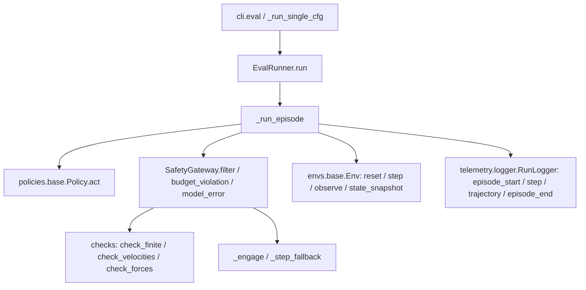

# NOW BUILD — MuJoCo-First Track (no hardware)

> Date: 2026-10-13 | Project: `A-physical-ai-harness` | Graph: 1121 nodes / 2622 edges / status: indexed / skipped:0 parse_partial:0
> Source: CURRENT_STAGE.md §8 + future.md + ROADMAP_PLATFORM_VISION.md §8 + planv2.md
> Entry: `aegis eval --model <policy> --sim mujoco --episodes N`

This is the maintenance file for items 4-14. Check boxes as you go. No hardware needed for 4-9 + 10-11 (MuJoCo).

## Graph — how to see it

MCP `codebase-memory-mcp` has no image popup. See it via:

1. `list_projects` -> confirms `A-physical-ai-harness` ready
2. `get_architecture(aspects=[overview,clusters,file_tree])` -> 12 clusters, file_tree 107 paths
3. `search_graph(query="eval batch parallel...")` -> finds `cli.eval_batch`, `eval/batch.py`, `eval/recommendation.py`
4. `trace_path(function_name="A-...EvalRunner.run", direction="both")` -> callers/callers map below
5. `query_graph` Cypher for custom views (example in §6)

Current core call graph (from `trace_path EvalRunner.run` 2026-10-13):



File map (from `file_tree`):

```
src/aegis/cli.py
src/aegis/eval/{runner.py, batch.py, recommendation.py, report.py, metrics.py}
src/aegis/envs/mujoco_pick_place.py
src/aegis/policies/{random,scripted,smolvla,groot}.py
src/aegis/safety/{gateway,checks,fallback}.py
src/aegis/telemetry/{logger,timing,otel}.py
src/aegis/ros2/bridge.py
configs/ + physical-ai.yaml
```

## 4. Parallel batching `--parallel N` [NEXT]

- What: `eval-batch` today sequential (`src/aegis/eval/batch.py:29 build_batch_report`, `cli.py:243 eval_batch`). Add parallel workers.
- Touches: `cli.py eval_batch`, `eval/batch.py combo_seed/combo_dir_name/build_batch_report`, `eval/runner.py EvalRunner`
- Accept: `aegis eval-batch --models scripted,random --parallel 4` same `report.json` as sequential, faster, deterministic `combo_seed = seed+idx`
- Status: [ ] spec in `docs/batching.md` -> [ ] implement -> [ ] test determinism

## 5. Dataset export flywheel [AFTER 4]

- What: `image_logger.py` + `data/export.py` parquet LeRobot + `aegis data-check validate.py`
- Touches: NEW `telemetry/image_logger.py`, NEW `data/export.py`, NEW `data/validate.py`, modify `eval/runner.py` + `cli.py`, docs `data-pipeline-decision.md`
- Accept: every eval writes `datasets/episode_*.parquet + metadata.json`, `data-check` catches NaN/missing col
- Status: [ ] image logger flagged storage-bounded -> [ ] exporter -> [ ] validator

## 6. learned_v1 recommendation

- What: replace 4-rule `heuristic_v1` (`recommendation.py:59 recommend`, `extract_features:23`) with trained classifier
- Touches: `eval/recommendation.py`, `eval/report.py _recommendation/build_report`, `docs/learned-recommendation.md`
- Features already logged: violations_per_ep, recoveries, success_rate — need Isaac+ROS2 runs to train
- Accept: outputs `{label, confidence, evidence}` with `recommendation_model: learned_v1`, calibrated
- Status: [ ] collect data -> [ ] train -> [ ] swap with fallback to heuristic

## 7. Second robot embodiment

- What: prove not Franka-only. Embodiment registry (RPY order, gripper scale, joint limits)
- Touches: NEW `configs/robots/<second>.yaml`, `config/models.py RobotSpec/SafetyLimits`, `policies/*` adapter, `envs/mujoco_pick_place.py`
- Accept: `aegis eval --robot <second>` 3/3 scripted, per-joint limits enforced
- Status: [ ] pick robot -> [ ] registry -> [ ] config + test

## 8. GR00T Phase B real-weights run (blocked on weights)

- Done: `GrootPolicySpec + kind:groot`, `configs/models/groot_n17.yaml`, `policies/groot.py` stub exit-2, 28/28 green
- Left: user drops `GR00T-N1.7-LIBERO` weights -> run `aegis eval --model groot --inference-mode cuda`, validate RPY roundtrip + 16-step chunk + gripper scale as fact
- Status: [ ] waiting weights

## 9. P3a camera calibration + expanded DR

- What: match sim cams to LIBERO train cams (`docs/camera-calibration.md`), expand DR beyond light/friction/camera jitter (`--dr`)
- Touches: `envs/mujoco_pick_place.py` DR, `configs/tasks/pick-place.yaml dr_*`, assets `pick_place.xml`
- Accept: SmolVLA 0/3 improves, DR stresses scripted measurably (today 1/1->1/2 on seed 42)
- Status: [ ] calibrate -> [ ] expand DR ranges -> [ ] A/B

## 10. RL loop

- What: `train/rl_env.py` Gym wrapper (gateway always-on) + `bc_trainer.py` + `aegis train-bc`
- Touches: NEW `train/__init__.py`, `train/rl_env.py`, `train/bc_trainer.py`, `cli.py train-bc`, needs #5 dataset
- Accept: train BC on scripted rollouts, re-eval through same gateway, no unsafe actions in training
- Status: [ ] rl_env -> [ ] BC trainer -> [ ] safety integration

## 11. Distill / quant int8 / LoRA toolkit

- What: shrink SmolVLA-450M / GR00T-3B for edge. Measure acc vs latency per quant level.
- Touches: `policies/smolvla.py`, `docs/perf-tuning.md --quantize int8`, NEW `policies/distill/*`
- Accept: report p50/p95 + success per quant level
- Status: [ ] spec -> [ ] quant harness -> [ ] distill

## 12. Edge runtime story (docs-first)

- What: C++/Rust gateway microsec, Jetson Orin, safety config as versioned artifact, OTA, shadow/canary, fleet dashboard + drift + compliance
- Touches: docs + `telemetry/otel.py`, `grafana/aegis_dashboard.json`, future `src/aegis_edge/`
- Accept: architecture doc + versioned `franka.yaml` deploy/rollback demo
- Status: [ ] arch doc -> [ ] sidecar prototype -> [ ] Jetson

## 13. Showcase <2min

- [ ] `demo.sh` validate->scripted 3/3->random 0/3->report
- [ ] README lead: 1 sentence + diagram + 1 cmd + Built-on-NVIDIA badge
- [ ] violation GIF, one-pager, What's Next section

## 14. Housekeeping

- [ ] recreate WSL `.venv` inside WSL2 or `UV_PROJECT_ENVIRONMENT`, `uv run pytest -q` green
- [ ] refresh `pytest_output.txt`, resolve pillow 12.2 vs 12.3 / transformers 4.57 vs 5.15 drift, torch cu128 Win vs WSL2 split
- [ ] keep `PRD.md` single source

## Order to start

```
4 parallel -> 5 export -> 10 RL-BC (uses 5) -> 6 learned_v1 (needs data) -> 7 2nd robot -> 9 calib/DR -> 11 quant -> 12 edge-doc -> 13 demo -> 14 housekeeping alongside
8 GR00T whenever weights land
```
